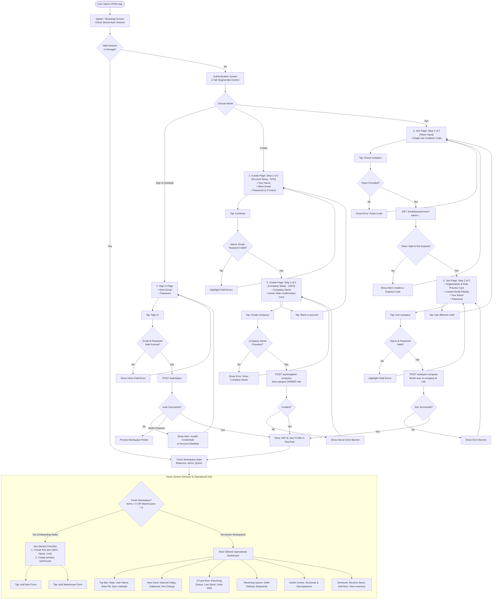

# NTAN Inventory — Auth, Onboarding & Home Screen Workflow

> **Document Type:** System Workflow & UI Architecture Diagram  
> **Platforms:** Mobile (iOS / Android) & Tablet  
> **Related Source Files:**  
> - [`AuthScreen.tsx`](../mobile/src/screens/AuthScreen.tsx)  
> - [`HomeScreen.tsx`](../mobile/src/screens/HomeScreen.tsx)  
> - [`theme.ts`](../mobile/src/theme.ts)  

---

## 1. High-Level System Workflow Diagram



---

## 2. End-to-End User Flow & Screen Map

```
┌────────────────────────────────────────────────────────────────────────────────────────┐
│                                   AUTHENTICATION HUB                                   │
├──────────────────────────┬─────────────────────────────┬───────────────────────────────┤
│    [1. SIGN IN (TAB)]    │     [2. CREATE (TAB)]       │       [3. JOIN (TAB)]         │
├──────────────────────────┼─────────────────────────────┼───────────────────────────────┤
│ • Work Email             │ STEP 1 (50%):               │ STEP 1 (Token Verification):  │
│ • Password               │ • Your Name                 │ • Invitation Code (Single-use)│
│ • Action: [Sign in]      │ • Work Email                │ • Action: [Check invitation]  │
│                          │ • Password (≥ 8 chars)      │                               │
│                          │ • Action: [Continue]        │                               │
│                          │                             │                               │
│                          │ STEP 2 (100%):              │ STEP 2 (Confirmation):        │
│                          │ • Company Name              │ • Org Preview Card            │
│                          │ • Role Notice (You = Owner) │ • Pre-assigned Role Pill      │
│                          │ • Action: [Create company]  │ • Your Name & Password        │
│                          │                             │ • Action: [Join company]      │
└──────────────────────────┴──────────────┬──────────────┴───────────────┬───────────────┘
                                          │                              │
                                          └──────────────┬───────────────┘
                                                         │
                                                         ▼
┌────────────────────────────────────────────────────────────────────────────────────────┐
│                                   HOME SCREEN / DASHBOARD                              │
├────────────────────────────────────────────────────────────────────────────────────────┤
│ [Top Bar]          TUESDAY, OCT 24 · Good morning, Amina  ·  [Northline · Owner] [Live]│
├────────────────────────────────────────────────────────────────────────────────────────┤
│ [Fresh Org Setup]  ⚠️ GET STARTED (Shown only if 0 items or 0 warehouses)              │
│                    [1] Create your first item  ──►  [2] Create a warehouse             │
├────────────────────────────────────────────────────────────────────────────────────────┤
│ [Hero KPI]         INBOUND TODAY: 1,420 units received into stock                      │
│                    Outbound: 570  │  Net Change: +850  │  Movements: 14                │
├────────────────────────────────────────────────────────────────────────────────────────┤
│ [Metric Cards]     [ 📥 3 Drafts ]        [ ⚠️ 4 Low Stock ]      [ 🛡️ 0 Held ]       │
│                    Receiving Queue        Reorder Point Alerts    Quarantined / Blocked│
├────────────────────────────────────────────────────────────────────────────────────────┤
│ [Receiving Queue]  • RC-2026-0042 (Supplier A · Main WH · 3 lines · 450 units)         │
│                    • RC-2026-0043 (Supplier B · Dock 1  · 1 line  · 80 units)          │
├────────────────────────────────────────────────────────────────────────────────────────┤
│ [Action Centre]    • SKU-1049 (Hydraulic Seal) — 2 available · Reorder at 10 [LOW]     │
│                    • SKU-2041 (Steel Bolt M8)  — 0 available · Reorder at 50 [OUT]     │
├────────────────────────────────────────────────────────────────────────────────────────┤
│ [Quick Shortcuts]  [ 📥 Receive Stock ]   [ 🏷️ Add Item ]   [ 📦 View Inventory ]      │
└────────────────────────────────────────────────────────────────────────────────────────┘
```

---

## 3. Screen-by-Screen Detailed Specifications

### Screen 1: Sign In (Login Page)

```
┌──────────────────────────────────────────┐
│  [Logo] NTAN INVENTORY                   │
│  INDUSTRIAL INVENTORY CONTROL            │
│  Stock that stays under control.         │
│  [Locations] [Audit-ready] [Role-based]  │
├──────────────────────────────────────────┤
│  ┌────────────────────────────────────┐  │
│  │ [ Sign in ]    Create      Join    │  │  <-- Mode Segmented Switcher
│  └────────────────────────────────────┘  │
│                                          │
│  ℹ️ Use your work account. New team      │
│     members need an invitation code.     │
│                                          │
│  Work email                              │
│  ┌────────────────────────────────────┐  │
│  │ you@company.com                    │  │
│  └────────────────────────────────────┘  │
│                                          │
│  Password                                │
│  ┌────────────────────────────────────┐  │
│  │ ••••••••••••••••                 👁│  │
│  └────────────────────────────────────┘  │
│                                          │
│  [             Sign in              ]    │
│                                          │
│  🔒 Need access? Ask your Owner or Admin │
│     for an invitation code.              │
└──────────────────────────────────────────┘
```

#### Fields & Values
- **Work email**: Text input (`keyboardType="email-address"`, `autoCapitalize="none"`). Validates non-empty and valid email syntax regex.
- **Password**: Masked secure input (`secureTextEntry={true}`). Validates non-empty.
- **Primary CTA**: `"Sign in"` with loading spinner during authentication.

---

### Screen 2: Create Page (2-Step Owner Registration)

#### Step 1: Account Setup (50% Progress)
- **Header Badge**: `STEP 1 OF 2 · ACCOUNT SETUP` (Track: 50% filled).
- **Your name**: Text input (`autoCapitalize="words"`, `autoComplete="name"`). Required.
- **Work email**: Text input (`keyboardType="email-address"`). Required.
- **Password**: Secure input (`textContentType="newPassword"`). Required (min 8 chars).
- **CTA**: `"Continue"` (Advances to Step 2 upon local validation).

#### Step 2: Company Setup (100% Progress)
- **Header Badge**: `STEP 2 OF 2 · COMPANY SETUP` (Track: 100% filled).
- **Company name**: Text input (`placeholder="Northline Trading"`, `autoCapitalize="words"`). Required.
- **Summary Box**:
  - Icon: `account-key-outline`
  - Text: *"Your account, `[email]`, will be the first Owner. You can invite the rest of the team after setup."*
- **Primary CTA**: `"Create company"` (Triggers API call `POST /auth/register-company`).
- **Secondary CTA**: `"Back to account details"` (Returns to Step 1 without wiping inputs).

---

### Screen 3: Join Page (2-Step Invitation Onboarding)

#### Step 1: Code Verification
- **Header Badge**: `STEP 1 OF 2 · INVITATION` (Track: 50% filled).
- **Invitation code**: Text input (`placeholder="Paste the code from your invitation"`, `autoCapitalize="none"`).
- **Helper hint**: *"The code is single-use and tied to the invited email address."*
- **CTA**: `"Check invitation"` (Calls `GET /invitations/preview?token=...`).

#### Step 2: Confirmation & Credentials Setup
- **Header Badge**: `STEP 2 OF 2 · INVITATION` (Track: 100% filled).
- **Invitation Preview Card**:
  - Company Icon + Company Name (e.g., `Northline Trading`)
  - Target Email (e.g., `user@company.com`)
  - Role Pill: `ROLE: OPERATOR` (or `SUPERVISOR`, `MANAGER`, `ADMIN`)
  - Expiry timestamp: *"Invitation expires Oct 28, 2026 at 18:00"*
- **Your name**: Text input for user's full name.
- **Password**: Secure input (min 8 characters).
- **Helper hint**: *"Use your existing password if this email already has an NTAN account."*
- **Primary CTA**: `"Join company"` (Calls `POST /auth/join-company`).
- **Secondary CTA**: `"Use a different code"` (Resets token and returns to Step 1).

---

### Screen 4: Home Page (Dashboard & Operational Flow)

#### 1. Header & Live Sync Status
- **Date label**: Uppercase formatted date (e.g., `SATURDAY, OCT 24`).
- **Greeting**: Context-aware greeting (`Good morning / afternoon / evening, [First Name]`).
- **Sub-greeting**: `[Company Name] · [Role Name]` (e.g., `Northline Trading · Warehouse Operator`).
- **Sync Badge**:
  - `Live` (Green `#1F7A5C` with `cloud-check-outline`)
  - `Updating` (Amber `#9A6A00`)
  - `Sync issue` (Red `#B42318` with `cloud-alert-outline` + retry button)

#### 2. First-Run Setup Checklist (Conditional)
*Visible only if `items.length === 0` or `warehouses.length === 0`:*
- **Step 1**: *"Create your first item"* (Redirects to item creation modal).
- **Step 2**: *"Create a warehouse"* (Generates receiving dock and main bins).

#### 3. Hero KPI Card ("Inbound Today")
- **Large Counter**: Inbound units received into stock today.
- **Trio Sub-counters**:
  - `OUTBOUND`: Units picked/issued today.
  - `NET CHANGE`: Difference between in and out (e.g., `+850`).
  - `MOVEMENTS`: Total count of transactions posted to ledger.
- **Meta footer**: 7-day volume totals + last refreshed relative time.

#### 4. Operational Metric Row (3 Cards)
- **Receiving Queue**: Count of draft receipts + total pending units.
- **Low Stock**: Count of SKUs below reorder point + stockout count.
- **Units Held**: Total units currently in quarantine or blocked status.

#### 5. Section Lists
- **Receiving Queue Feed**: Top 3 draft receipts with supplier, warehouse name, and item counts.
- **Needs Attention Feed**: Critical low stock / stockout items with current available stock vs reorder threshold.
- **Quick Shortcuts**: One-tap triggers for `Receive Stock`, `Add an item`, and `View inventory`.

---

## 4. UI Style Tokens Cheat Sheet

| Category | Token | Value | Target Usage |
|---|---|---|---|
| **Colors** | `primary` | `#2E5BBF` | Primary CTAs, active tab backgrounds, main links |
| | `navy` | `#213767` | Screen headers, KPI card backgrounds, dark text |
| | `deep` | `#1C5C93` | Icons, role badges, step indicator track |
| | `surface` | `#F5F9FC` | Screen canvas background |
| | `white` | `#FFFFFF` | Card surfaces, input box backgrounds |
| | `border` | `#D6E2EC` | Input borders, card dividers |
| | `accent` | `#FBCC00` | Scanner reticle, high-visibility badges |
| | `success` | `#1F7A5C` | In-stock status, live sync pill |
| | `warning` | `#9A6A00` | Low stock alerts, draft receipts |
| | `danger` | `#B42318` | Out of stock, error banners, discrepancy |
| **Typography** | `fonts.heading` | `Raleway_700Bold` | Screen titles (22–26 pt), Card titles (17–19 pt) |
| | `fonts.body` | `OpenSans_400Regular` | Form field labels (14 pt), body text (14–15 pt) |
| | `fonts.bodySemi` | `OpenSans_600SemiBold`| Eyebrows, button labels, badge pills |
| **Spacing** | `sm` / `md` / `lg` | `8` / `12` / `16` pt | Input padding, inter-card gaps |
| **Touch Target** | Minimum Size | `48 × 48` pt | All buttons, tabs, row items (Glove & Stylus ready) |
